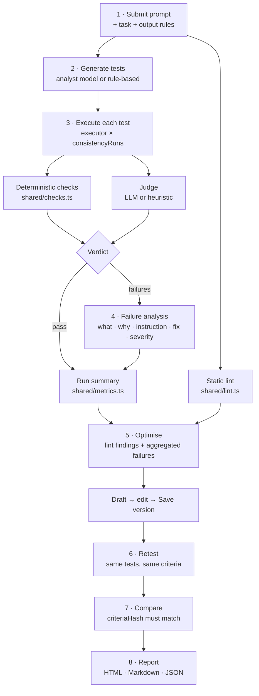
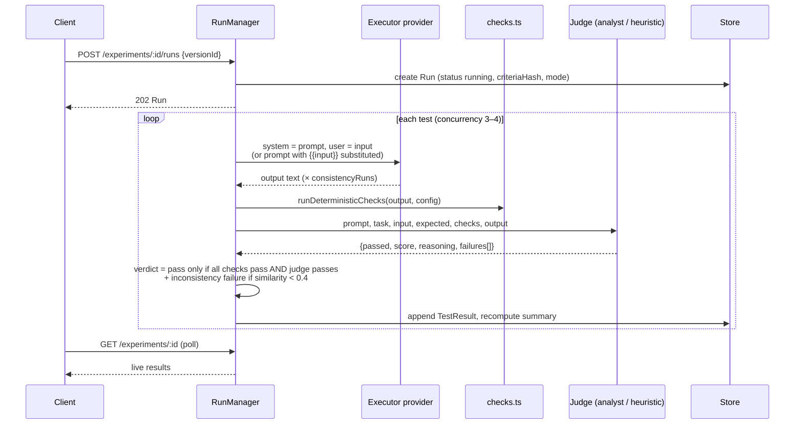

# Architecture

## 1. System architecture

```mermaid
flowchart LR
  subgraph Browser["Browser: React 19 SPA (client/)"]
    UI[Pages: Dashboard · Studio · Test Lab · Failures · Optimizer · Compare · History · Reports · Settings]
    ST[App state + polling<br/>lib/state.tsx]
    UI --> ST
  end

  subgraph Server["Node.js: Express 5 API (server/)"]
    R[routes/api.ts<br/>zod validation]
    RM[core/runner.ts<br/>RunManager]
    TG[core/testGenerator.ts]
    J[core/judge.ts]
    O[core/optimizer.ts]
    REP[core/report.ts]
    REG[providers/registry.ts]
    STORE[(store/experimentStore.ts<br/>data/experiments.json)]
    R --> RM & TG & O & REP
    RM --> J
    RM & TG & O & J --> REG
    R & RM --> STORE
  end

  subgraph Shared["shared/ (used by both sides)"]
    T[types.ts]
    L[lint.ts]
    C[checks.ts]
    M[metrics.ts]
  end

  subgraph Providers["LLMProvider implementations"]
    A[AnthropicProvider<br/>@anthropic-ai/sdk]
    OC[OpenAICompatibleProvider<br/>fetch /chat/completions]
    D[DemoProvider<br/>offline simulator]
  end

  ST -- "REST /api (JSON)" --> R
  REG --> A & OC & D
  A --> CL[(Claude API)]
  OC --> ANY[(OpenAI / Ollama / OpenRouter / …)]
  Server -. imports .-> Shared
  Browser -. imports .-> Shared
```

**Key decisions**

| Decision | Rationale |
|---|---|
| One `LLMProvider` interface (`complete(req) → text`) | Services never contain provider-specific logic. Adding a provider means one class plus one registry entry. |
| Two roles: *executor* and *analyst* | The model under test should be your production model; generation and judging benefit from a stronger model. |
| Provider calls only on the server | Keeps API keys out of the browser. |
| JSON output via prompt + robust extraction + zod validation + one repair retry | Works with every provider, including local models without structured-output support. |
| Shared `types/lint/checks/metrics` | One API contract. The static linter runs live in the browser and the same rules run on the server. |
| JSON-file store with atomic writes | Zero setup for a university demo. The store interface is small so it can be swapped for SQLite or Postgres. |
| Background runs + client polling (900 ms) | Simple, robust progress reporting with no websocket infrastructure. |
| Demo mode is a provider, not a UI mock | The whole pipeline (checks, judge, metrics, reports) runs on demo output, and `mode: "demo"` is stored on every run so it can't be confused with live data. |

## 2. Prompt-testing workflow



## 3. Input/output flow of a single test



Rules that keep results honest:

- **Errors are not failures.** Provider or judge errors produce `verdict: "error"`, are excluded from the pass rate, and a run where every test errors is marked `failed`.
- **No pass without evaluation.** If the judge can't evaluate, the result is `error`, never `pass`.
- **Fair comparisons.** Each run stores a `criteriaHash` over the output rules and the test contents. The Comparison Studio warns when two runs differ in tests, criteria or mode.
- **History is immutable.** Editing a prompt that already has results creates a new version, and each run snapshots the config it was evaluated with.

## 4. Data model (abridged)

```
Experiment
 ├─ config: { prompt, taskDescription, outputFormat, formatDetails, constraints, consistencyRuns }
 ├─ testCases[]: { id TC-001, input, category, expectedBehavior, rationale, source }
 ├─ versions[]: { id, label, prompt, origin original|optimized|manual, optimization? }
 ├─ runs[]: { versionId, scope full|partial, status, mode live|demo, executor, analyst,
 │            criteriaHash, results[]: TestResult, summary: RunSummary }
 └─ draft?: unsaved optimiser output
TestResult: { output, outputs[], checks[], judge, verdict, failures[]: Failure, consistency, latencyMs }
Failure: { type, severity critical|high|medium|low, what, why, instruction, fix, source rule|judge }
```

## 5. Extending

- **New provider**: implement `LLMProvider` in `server/providers/`, add it to `ProviderRegistry.status()` and `get()`, and add the id to `ProviderId`.
- **New check**: add it to `shared/checks.ts` (and its explanation to `failuresFromChecks`).
- **New lint rule**: add it to `shared/lint.ts`. It appears in the Studio and the optimiser automatically.
- **Different storage**: replace `ExperimentStore` (methods `list/get/put/touch/delete/flush`).
